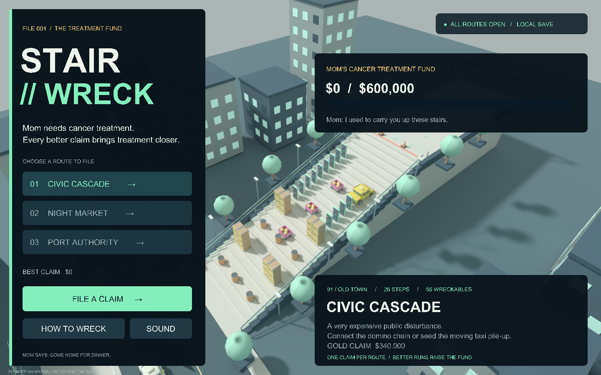

# STAIR // WRECK

A complete three-route arcade crash game built with Godot and original Blender assets. Charge a skateboard launch, build speed down the stairs, then turn your ragdoll landing into a domino cascade of carts, crates, explosive drums, and taxis.

**Play:** open `builds/StairWreck.app` or double-click `Play.command`. The self-contained universal macOS app includes its engine; Godot and Blender are not needed to play. A distributable archive is in `builds/StairWreck-macOS.zip`. macOS 11 or later.



The image above is a Blender validation render of the instantiated Godot scene and interface layout. Native Godot window capture was unavailable in the build session. See [validation details](docs/VALIDATION.md).

## Play the cascade

Choose a route, select your starting lane, and hold **Space** to charge. Release to launch. Hold **W** to push; gravity adds speed on the stair descent. Hit an obstacle or press **Space** again to bail.

Once you crash, the rider has eleven physical body parts joined into a ragdoll, with a separate physical skateboard. Use aftertouch and three crashbreaker shockwaves to reach another destruction cluster. Wrecks pass momentum to other objects; explosive drums can trigger further drums. Fresh wrecks maintain a 3.5-second cascade window and build a multiplier up to ×8. Objects score once, while measured rider impacts earn additional points.

| Control | Action |
| --- | --- |
| A / D or ← / → | Choose a starting lane, steer, apply airborne aftertouch |
| Hold / release Space | Charge / launch |
| W or ↑ | Push for speed |
| Space while riding | Bail |
| Shift after bailing | Crashbreaker, three per run |
| Hold Tab | Slow motion |
| C | Cycle chase, side, and overhead cameras |
| R | Restart the route |
| V on results | Replay the recorded crash |
| Enter | Start from menu or retry from results |
| Esc | Pause / resume; return to routes from results |
| H | Controls and crash guide |
| M | Toggle sound |

Each run ends when the crash settles or after 19 seconds of crash simulation. Results include property damage, rider impacts, objects wrecked, explosions, longest cascade, peak speed, and a medal. Personal bests and sound preference persist locally. All routes are open from the start.

## Three routes

- **Civic Cascade:** 26 concrete stairs, three domino lanes, stacked cargo, rolling drums, and a taxi rank. Gold: 340,000.
- **Night Market:** 32 stairs under lanterns and neon awnings. Fruit carts collide with dominoes and a fireworks drum supply. Gold: 325,000.
- **Port Authority:** 38 stairs, cranes, containers, cargo towers, and a terminal drum avalanche. Gold: 550,000.

Different launch speeds, lines, bail points, and boost timing create different physical outcomes. A boost can rescue a stalled chain or send you past a useful target.

## Develop and verify

Open `project.godot` in Godot. Tested with **Godot 4.7.2**. The source uses Godot 4 APIs and the Compatibility renderer. The macOS package uses the installed official universal Godot binary with an exported game PCK, so it is larger than a dedicated release-template build.

```sh
./tools/test.sh
./tools/build_macos.sh
```

The tests cover score and medal rules, staircase boundaries, all three complete gameplay loops, nine starting lines, real collision propagation, ragdoll joints, manual bail, finite boosts, pause, slow motion, replay, persistence, and interface text bounds. The runner fails on script errors and resource leaks as well as failed assertions.

Original editable assets: `blender/stair_wreck_assets.blend`. The 15 model exports are in `assets/models/`. `blender/build_assets.py` regenerates them; this project generated them through the **Blender MCP background executor**. `tools/generate_audio.py` generates the original synth soundtrack and all effects without external samples.

`tests/render_snapshot.gd` exports actual runtime geometry, camera transforms, and Control bounds for `blender/render_validation.py`. Its Blender CPU renders are useful for inspecting sightlines and composition when a native display is unavailable. They use a different renderer and substitute font, so they are not native Godot screenshots.

Game code, models, and audio are MIT licensed. The bundled engine and third-party notices are in `docs/GODOT_LICENSE.txt` and the app's Resources folder.
