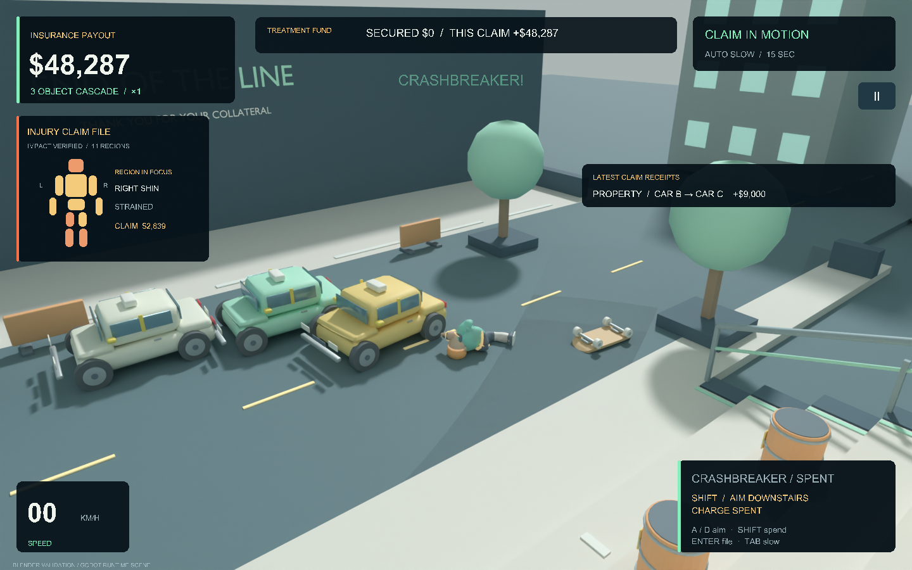
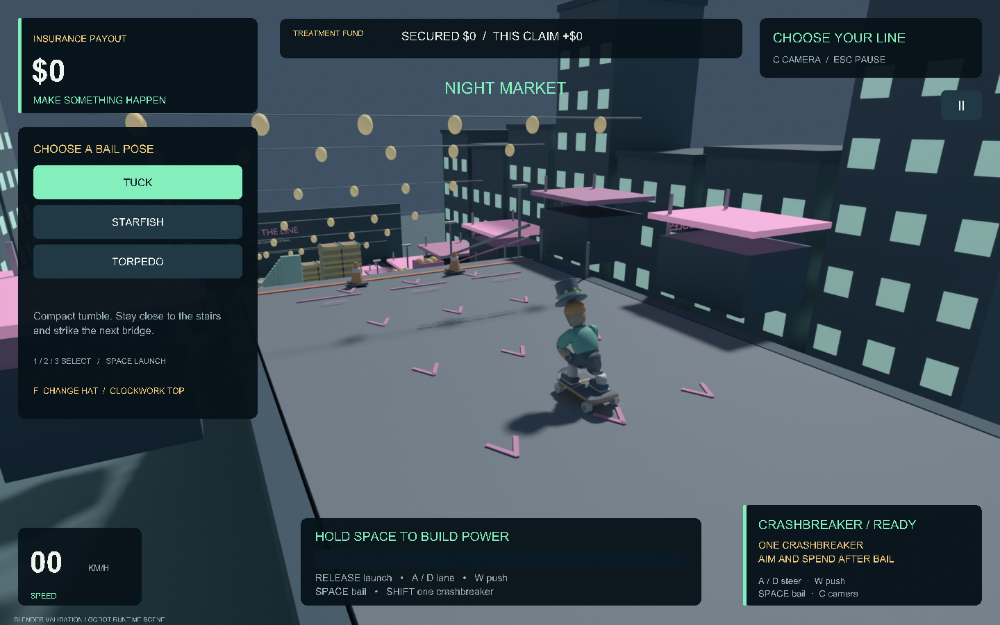
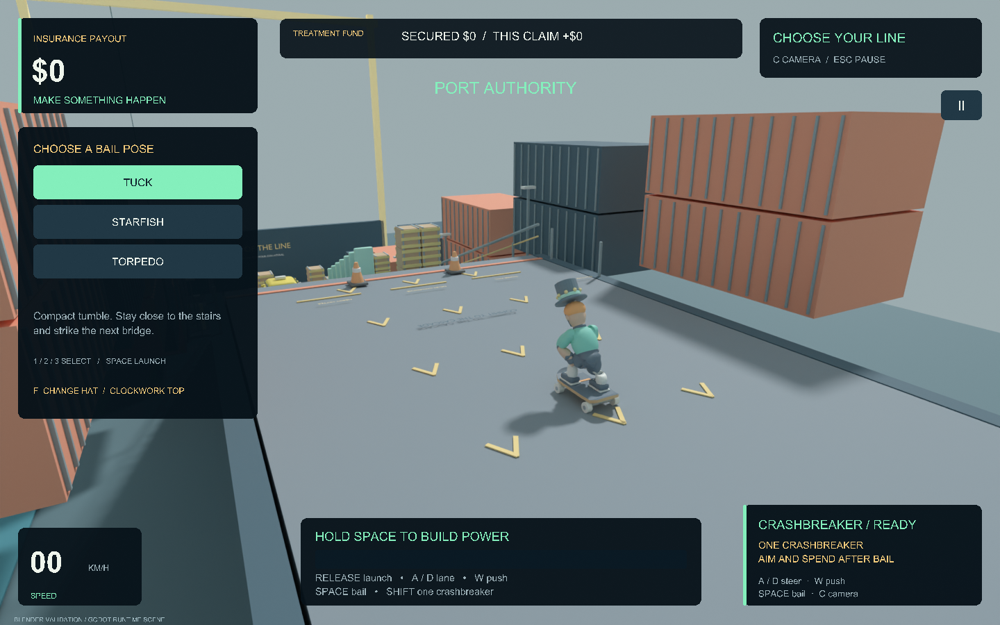

# STAIR // WRECK

**Choose a line. Build speed. Make the next collision count.**

A three-map skateboard crash game built in Godot, with original Blender assets and synthesized audio. Bail into an eleven-part ragdoll, connect a chain of falling cargo and moving traffic, then spend your **one crashbreaker** to reach the next cluster.



*Historical v3.0 Blender reconstruction of exported Godot runtime geometry and UI. Current gameplay GIFs are pending; [capture all three maps](docs/CAPTURE_GAMEPLAY.md) from a graphical desktop session.*

## Play

Open `project.godot` in **Godot 4.7.2**, let it import, and run the main scene. The project uses the Compatibility renderer. From the project directory:

```sh
godot --path .
```

On macOS, `Play.command` also runs the current source; set `GODOT_BIN` if your engine lives elsewhere.

An existing local checkout may contain the [verified macOS repair candidate](docs/repair/evidence/R13.md). Its ZIP lives under ignored `builds/candidates/` and is **not included in a fresh source-only clone**. The original `builds/StairWreck.app` is the historical v3.0 build.

## One attempt, several decisions

Choose **Tuck, Starfish, or Torpedo**, pick a lane, and charge the launch. Kick on the run-up, carve toward a target, and bail deliberately—or let the first obstacle do it. Aftertouch guides the fall; Shift spends the single crashbreaker on a directional relaunch and a short, obstructable shove.

Dominoes tip, carts roll, cargo towers collapse, and drums burn through visible fuses before exploding. Traffic follows route-specific lanes and brakes for hazards. A collision hands control from the driver to the rigid body, so a wreck can carry its momentum into the next car. The claim feed names the actual chain: `RIDER → CAR A → CAR B → CAR C`.

| Route | Steps | Opening possibilities |
| --- | ---: | --- |
| **Civic Cascade** | 26 | Domino run, carts, heavy taxi and stacked crates |
| **Night Market** | 32 | Cart slalom, cargo drop and a domino fuse line |
| **Port Authority** | 38 | Cargo towers, a drum avalanche and terminal traffic |

| Night Market | Port Authority |
| --- | --- |
|  |  |

*Historical Blender validation renders; native lighting and motion remain unverified.*

Your score is a fictional insurance claim. The best claim from each route contributes to a **$600,000 treatment fund for Mom**; retries bank only improvements. Injury receipts, a body diagram, and persistent bruises explain the settlement. Replay revisits the crash without earning money again. Records, preferences, and hats stay local.

| Control | Action |
| --- | --- |
| A / D or ← / → | Select lane, steer, aftertouch, aim crashbreaker |
| Hold / release Space | Charge / launch |
| W or ↑ | Kick on the run-up |
| Space while riding | Bail |
| 1 / 2 / 3 · F | Select pose · change hat before launch |
| Shift · S or ↓ | Spend crashbreaker · aim uphill after bailing |
| Hold Tab · Enter | Extra slow motion · settle the live claim early |
| C · V on results | Change camera · replay |
| R · Esc · H · M | Retry · pause · controls · mute |

## Inside the simulation

The interesting engineering lives at the boundaries between movement, physics, presentation, and persistence:

- **Skating → ragdoll:** swept collision proxies find the first obstruction; the bail transfers the rider into connected rigid bodies while a weighted character mesh follows the physical pose. See [contacts](scripts/skating_contacts.gd) and [rider](scripts/rider.gd).
- **Driver → wreck:** traffic uses bounded motor and braking forces. Impact authority disables the motor; causal contact evidence controls once-per-car payouts. See [traffic](scripts/traffic_car.gd).
- **Simulation → replay:** time-stamped actor and camera tracks feed an isolated, inert presentation. Playback owns its visual state and cannot mutate the live claim. See [timeline](scripts/replay_timeline.gd) and [presentation](scripts/replay_presentation.gd).
- **Claim → secured funds:** settlement accounts for moving bodies and pending fuses. A claim remains pending until durable storage acknowledges it; failed saves expose retry and protected-profile recovery. See [settlement](scripts/crash_settlement.gd) and [records](scripts/records_store.gd).

The [asset pipeline](docs/ASSET_PIPELINE.md) retains editable Blender studios and generators for **19 GLB models**. Python scripts synthesize **15 audio assets** without external samples. The project runs physics at 90 Hz; slow motion uses a separate presentation clock.

## Verify locally

```sh
./tools/test.sh
# Explicitly omit the strict editor-import gate:
GODOT_BIN=godot ./tools/test.sh --runtime-only
```

The recorded [final integration run](docs/repair/evidence/R12.md) passed **31 runtime suites and 10,807 assertions** covering real collisions, inputs, skin transfer, replay isolation, save recovery, UI geometry, and lifecycle cleanup. That is historical evidence, with repeated per-frame and per-limb checks; it is not 10,807 independent scenarios. A separate [ordinary-key campaign trace](docs/repair/evidence/R12_good_play.md) reached the unchanged treatment goal without injected money or impulses.

The runner keeps per-run commands, logs, isolated profiles, deadlines, and machine-readable results under `builds/test_runs/`. Strict import failed in the recorded sandbox because Godot could not write editor state; runtime-only results use checked existing import-cache bytes. Native motion, audible mixing, frame rate, high-DPI interaction, and human playability remain open [validation limits](docs/repair/evidence/R14.md). Headless tests and Blender reconstructions do not establish those results.

If startup reports missing imported resources, open the project in the editor and finish importing before retrying. For another engine path, use `GODOT_BIN=/path/to/godot ./tools/test.sh`. Save errors keep the claim pending; use the results screen's Retry Save or protected-profile recovery rather than overwriting the profile.

Game code, models, and audio are [MIT licensed](LICENSE). [Godot and third-party notices](docs/GODOT_LICENSE.txt) are included.

The local Git history was reconstructed retrospectively from saved source archives and session logs. [History provenance and limits](docs/HISTORY_RECONSTRUCTION.md).
