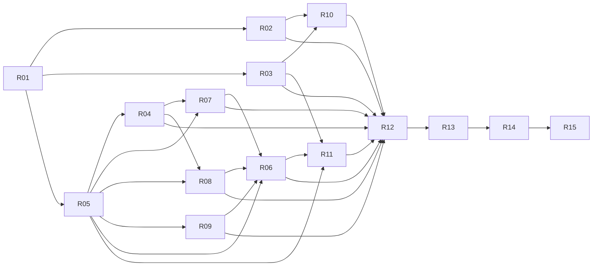

# STAIR // WRECK — stability repair plan

Status: planning deliverable; gameplay fixes have not been implemented by this audit.
Date: 2026-10-04.
Workspace: `/Users/tyler/Documents/GitHub/stair-dismount`.
Target: existing Godot 4.7.2 Compatibility game and its universal macOS package.

## Outcome and scope

A player can launch, steer, crash, spend exactly one crashbreaker, watch the cascade,
settle the claim, replay it, and retry on all three routes without hidden UI actions,
phantom collisions, timing distortions, silent record loss, or an obsolete launcher.
The game keeps the skateboard run-up, articulated injury display, moving traffic,
three themed routes, designer hats, and the $600,000 treatment-fund story.
This is a repair pass on the existing game, not a replacement engine or art overhaul.

User reports of glitches take priority over the previous test count.
Passing accounting tests cannot establish stable camera motion or correct contacts.
Each confirmed defect receives a reproduction and an independent acceptance oracle.
Remaining visual and audio hypotheses receive investigation gates rather than invented diagnoses.

## Repository and runtime facts

- `scenes/main.tscn` instantiates the programmatically built game in `scripts/main.gd`.
- `main.gd` owns MENU, READY, RUN, CRASH, RESULTS, REPLAY, clocks, saves, and camera.
- `world_builder.gd` builds real treads, props, and finite physically driven traffic.
- `rider.gd` animates riding and creates eleven rigid body parts plus a separate board.
- `rider_skin.gd` drives the continuous imported character skeleton from those parts.
- `traffic_car.gd` owns DRIVE, BRAKE, UNCONTROLLED, and SETTLED driver states.
- `crash_prop.gd` owns armed, fuse, damaged, and payout callbacks.
- `game_rules.gd` owns capped injury payout and one payout per property object.
- `game_hud.gd` builds menus, controls, pause/help, receipts, replay, and campaign UI.
- `sound_director.gd` owns music, rolling, engine, and one-shot sound playback.
- `project.godot` currently uses 90 physics ticks per second without interpolation.
- `tools/test.sh` launches thirteen headless suites at fixed rendering FPS 60.
- `Play.command` currently launches the old app whenever it exists.
- The current ZIP, PCK, and app bytes are consistent and the signature verifies.
- There is no project Git repository or project AGENTS.md in this workspace.
- Headless Godot works; actual native play/render/audio was not verified by this audit.

Do not invent Git history, CI requirements, external-model reviews, or a native screenshot.
Inspect any new AGENTS.md before implementation if one appears later.

## Confirmed incident register

| ID | Priority | Observable failure | Evidence | Repair |
|---|---|---|---|---|
| F01 | P1 | A taxi side pass with 0.458 m actual clearance enters CRASH | `physics_report.json`, near_miss | R04 |
| F02 | P1 | Port wheels float up to 0.920 m above the staircase with real push cadence | `physics_report.json`, descents | R04 |
| F03 | P0 | Enter activates a focused underlying menu or pose button through help/pause | `state_ui_probe.json` | R03 |
| F04 | P1 | Holding Tab slows the game only when GUI focus is absent | `state_ui_probe.json` | R03 |
| F05 | P1 | C changes replay camera_style but leaves the replay camera unchanged | `state_ui_probe.json` | R06 |
| F06 | P1 | Replay omits recorded lens FOV | `state_ui_probe.json` | R06 |
| F07 | P1 | Replay assumes .05 s intervals although recorded intervals vary by time rate | `camera_clock_probe.json` | R05, R06 |
| F08 | P1 | Camera candidate inside a real collider is incorrectly treated as clear | `camera_clock_probe.json` | R07 |
| F09 | P1 | Camera floor clamp after look_at invalidates the already-computed aim | constructed `camera_clock_probe.json` | R07 |
| F10 | P0 | Invalid saved field types cause SCRIPT ERROR after partially mutating records | `records_*.log` | R02 |
| F11 | P0 | A version-99 save is rewritten as version 2, losing unknown data | `records_future_version.log` | R02 |
| F12 | P0 | Truncated JSON later becomes a zeroed save with no recovery | `records_malformed.log` | R02 |
| F13 | P0 | Failed save still produces RESULTS with $200,000 reported secured | `settlement.log` | R02, R10 |
| F14 | P1 | Test-mode startup overrides unique fixtures and loads shared previous scores | `startup_isolated.json` | R01 |
| F15 | P1 | A spinning traffic wreck settles while angular speed is 2.93 rad/s | `settlement_report.json` | R09 |
| F16 | P1 | Source repairs do not reach Play.command while an old app exists | launcher inspection | R13, R15 |

All JSON/log paths in this register are under `builds/repair_audit/`.
F09 establishes incorrect operation order under a constructed camera placement;
its frequency and severity in normal native play remain unmeasured.
F15 is a real spinning-body scenario, not evidence that every attempt ends prematurely.
The measured simple ragdoll probes kept joint anchors within 0.025 m;
do not assert that those cases prove exploding joints or require a full rig rebuild.

## Hypotheses requiring observation

- Slow motion may appear stepped when physics updates are rendered without interpolation.
- Smoothing toward a clear camera candidate can traverse a blocked intermediate position.
- Skin updates from more than one callback may disagree during clock transitions.
- Replay can retain live particles, lights, or audio inappropriate to the sampled moment.
- Focus loss while holding charge, steering, or slow motion may leave ambiguous input state.
- Dense cascades and repeated route replacement may expose freed-node or resource errors.
- Text and focus order may be unusable at some native window sizes or scale factors.

A hypothesis is not a confirmed defect until its probe or native observation fails.
Keep the issue open only for the required investigation if the baseline is already correct.
An investigation may conclude no gameplay edit is warranted, with evidence attached.

## Shared contracts for implementation

### Movement and collision

The riding controller remains an arcade controller with explicit geometry queries.
Use a bounded board/rider envelope oriented with heading, not a scalar prop radius.
Read actual prop CollisionShape3D geometry and identify the first swept obstruction.
Check initial overlap separately: Godot cast_motion ignores shapes already intersecting.
Ordinary treads support riding and do not act like vertical crash obstacles.
The real tread bodies remain available for ragdoll injury collisions after bail.
A supporting height profile may follow the stair noses with bounded visual wheel bounce.
Its height must agree with independent actual tread support queries within stated tolerances.
Never repair hovering by altering the verification helper to agree with a production formula.
Avoid a wholesale CharacterBody3D/wheel suspension conversion unless the bounded query
approach demonstrably cannot meet R04; record evidence and revise the plan first.

Why: the current gap is an incomplete arcade collision contract, not a missing engine.
A new movement architecture can stop the board on every riser or erase the crash physics.
Small, measured changes preserve the intended fast, readable stair descent.

### Clocks and presentation

Simulation time advances only with actual simulated physics delta.
Presentation/wall time uses a monotonic clock with an explicit pause baseline.
A callback must not divide an old delta by a newly changed Engine.time_scale.
Physics body transforms have one simulation owner; presentation cannot feed them back.
Retain the 90 Hz solver unless a measured comparison supports a change.
Time rates remain normal 1.0, crash .55, held slow .25, and impact .18.
Impact/cooldown durations use presentation time; fuse, damage, and contact logic use simulation time.
R05 defines interpolation ownership and reset behavior before R04/R08/R06 integrate.
Skin/bone interpolation needs explicit ownership; toggling the global setting alone is insufficient.

Why: slow motion magnifies inconsistent update clocks and missing render interpolation.
Changing solver rate to conceal stepping risks altering collisions and payout.

### Input and modal state

All gameplay actions use one phase/modal/focus policy even when invoked by HUD signals.
Help and pause trap keyboard focus as well as mouse events.
Live gameplay hotkeys work regardless of a previously focused non-modal Button.
MENU and RESULTS retain keyboard button navigation.
Charge launches on a matching release only if its press began in eligible READY state.
Focus loss and entering a modal clear held action latches; reacquiring focus needs a new press.
In READY/RUN/CRASH/REPLAY focus loss pauses; focus gain requires explicit Resume.
Existing help/pause suspension is preserved, and MENU/RESULTS remain in phase.
If focus was lost while HELP owned live suspension, closing HELP returns to PAUSE until Resume.
One crashbreaker charge per attempt is consumed before callbacks, unchanged by replay.

Why: Godot routes GUI input before _unhandled_input; blocking only that callback
cannot prevent focused controls from accepting Enter or consuming Tab.

### Replay

Replay uses a sorted immutable tape with explicit simulation timestamps and stable actor IDs.
Store the initial crash snapshot and the exact final settlement snapshot.
Bracket by stored timestamps; do not reconstruct time from frame index times .05.
Interpolate transforms and FOV; apply discrete damage, fuse/lamp states, receipts,
and event visibility at their recorded timestamp without re-running physics or payment.
The default replay view reproduces the recorded camera; C selects chase, side, overhead
using replayed actor focus, never the currently frozen final body position.
Replay is a presentation layer and may not mutate live payout/cause/armed/fuse records.
Alternate-view queries use replay-time prop hulls plus static route geometry and ignore frozen final hulls.
Replay audio is music-only for this repair; visible receipts are recorded without live sound callbacks.
Exit restores the final live state and result UI exactly.

Why: a replay should explain the causal crash the player just made, and make the
advertised camera control useful without creating a second simulation or payout path.

### Records and settlement

Use candidate validation before modifying in-memory state.
Support v1 migration and current v2 records only; preserve unsupported newer records.
Accept score numbers only when finite, non-negative, integral, and within the documented cap.
A malformed optional field defaults independently; a malformed best-score record is quarantined,
with a valid backup offered for recovery instead of silently replacing it with zeros.
Treat missing files as a clean first run; treat inaccessible/corrupt files as distinct failures.
Serialize a complete candidate into a same-directory temporary file, verify it,
retain the last good backup, then replace the primary and inspect every error result.
Test replacement/recovery semantics on the target filesystem; do not promise power-loss durability.
Store failure leaves a session-best candidate and a persistent retry state.
The HUD distinguishes session improvement from banked persistent funding.
Only successful durable commit earns “secured” wording and a newly funded ending.
Retrying save cannot add the improvement twice.
No-backup fresh recovery is explicit and preserves corrupt originals before replacement.
An uncertain post-replacement result reconciles validated disk state before another write.
Restoring old funding alone cannot count as new earnings or trigger a newly-funded ending.

Why: the story makes losing a best claim especially costly, and current failures are silent.
A small transactional records service prevents partial mutation and false success UI.

### Evidence and release

Each suite starts with a unique fixture before _ready and cannot touch a real user save.
The runner imposes per-process deadlines and rejects unexpected script/engine errors.
Do not broaden testing just to raise an assertion count; verify outcomes at system seams.
Automated correctness and native play/render/audio are separate recorded gates.
A Blender render is asset evidence, not a screenshot of Godot gameplay.
Candidate app/ZIP/source have a build ID and source/assets digest manifest.
Native validation plays the extracted candidate ZIP before final promotion.
Do not claim human enjoyment, stable FPS, or native visual correctness from headless scores.

## Task dependency graph

R01 is the only initial ready task. It supplies isolated reproduction infrastructure.
R02, R03, and R05 can then proceed independently with file ownership respected.
Shared main.gd edits still require one writer at a time; dependency readiness does not permit
concurrent writes to the same file in this workspace without isolated copies and integration.
The final release task R15 is the intentional sink; every other task has a consumer.

Full task descriptions are in `tasks/R01.md` through `tasks/R15.md`.
`task_graph.json` is the machine-readable list of keys, priorities, prerequisites, and owners.
Bead descriptions copy each task verbatim; links are supplements rather than required context.
Implementation updates each task only after its actual acceptance evidence exists.
A task cannot close merely because it added tests, a stub, or a new passing mock.

## Execution and completion

1. Preserve the current reproductions and capture a source/package baseline.
2. Isolate test startup and fix the damaging input/save failures first.
3. Establish clock ownership, then repair riding, camera, bodies, and settlement.
4. Record a faithful replay and complete UI/audio state integration.
5. Run bounded stress scenarios across all routes and supported interactions.
6. Build and inspect an extracted candidate ZIP with source identity checks.
7. Observe actual native gameplay, UI, slow motion, audio, and restart persistence.
8. Promote the candidate and document the exact verified scope.

No engine upgrade, new route, subscription service, multiplayer, telemetry backend,
new procedural art pack, or cross-platform release is required for this repair.
Additional feature ideas belong after stability; they cannot displace a failing acceptance case.
The previous external Gemini swarm could not start under sandbox socket restrictions.
This plan uses actual available internal reasoning agents for its review rounds;
no Claude, Gemini, Grok, or GPT Pro participation is claimed without a real invocation.

## Primary technical references

Verified 2026-10-04 against the installed Godot 4.7.2 target:

- [PhysicsDirectSpaceState3D](https://docs.godotengine.org/en/4.7/classes/class_physicsdirectspacestate3d.html): sweep fractions and initial-overlap limitations.
- [PhysicsRayQueryParameters3D](https://docs.godotengine.org/en/4.7/classes/class_physicsrayqueryparameters3d.html): hit_from_inside and RID exclusions.
- [Physics interpolation](https://docs.godotengine.org/en/4.7/tutorials/physics/interpolation/using_physics_interpolation.html): tick ownership and reset on placement.
- [Node3D](https://docs.godotengine.org/en/4.7/classes/class_node3d.html): interpolated global transforms for presentation.
- [RigidBody3D](https://docs.godotengine.org/en/4.7/classes/class_rigidbody3d.html): force integration ownership.
- [CharacterBody3D](https://docs.godotengine.org/en/4.7/classes/class_characterbody3d.html): explicit scripted motion; alternative only after evidence.
- [FileAccess](https://docs.godotengine.org/en/stable/classes/class_fileaccess.html): open/error/flush/close behavior; stable URL is unpinned, verify against local 4.7 runtime.
- [DirAccess](https://docs.godotengine.org/en/4.7/classes/class_diraccess.html): rename/copy error returns; filesystem crash behavior requires tests.

Audit reports provide the exact source locations and reproduction commands.
Review transcripts and revision decisions are kept in `reviews/`.
Plan validation records graph checks, standalone task review, rationale sampling,
revision diffs, and the final br task mapping without rewriting beads storage by hand.
